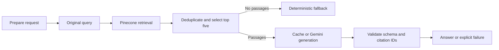

# RunbookIQ

Evidence-based troubleshooting for a **fictional** order-processing service.
Python + LangGraph + Pinecone integrated embeddings + Gemini + local Streamlit.

RunbookIQ finds documented checks and historical lessons, displays cited passages,
and states when evidence is insufficient. It cannot inspect a live system,
establish a current root cause, or execute remediation.

## Quick start

Python 3.12 and [uv](https://docs.astral.sh/uv/) are required. Run commands from the repository root.

```sh
export UV_CACHE_DIR="$PWD/.uv-cache"
uv sync --locked
cp .env.example .env
# Edit .env locally: PINECONE_API_KEY and GEMINI_API_KEY.
uv run runbook-iq doctor --offline
uv run runbook-iq tokenizer-setup
uv run runbook-iq corpus build
uv run runbook-iq ingest --dry-run
```

Before live calls, confirm your Pinecone Starter and Gemini free-tier account in
their consoles. `config.yaml` records this session's user-confirmed tiers; these
settings are assertions, not a billing API check. Recheck them for another account.
No API key belongs in YAML, Git, chat, screenshots, or evaluation reports.

```sh
uv run runbook-iq doctor --pinecone --gemini
uv run runbook-iq ingest
uv run runbook-iq ask --question 'What documented checks distinguish database pool exhaustion from an inventory dependency timeout in order-api?'
uv run streamlit run app.py --server.address 127.0.0.1 --browser.gatherUsageStats false
```

The index is `runbook-iq`, namespace `runbook-iq-v1`, in AWS `us-east-1`.
Ingestion creates it if absent, with an ownership tag and deletion protection;
an existing index must match the ownership/model/region/field settings. It never
deletes an index. Local ingestion state is bound to index host/name and namespace;
use a separate processed directory for another destination. Repeated unchanged ingestion skips all embedding/upsert calls.
App startup and questions never ingest. If synchronization is interrupted, restore
the same candidate corpus and rerun `ingest`; questions refuse incomplete state.

`doctor --offline` checks shell key presence only. Live commands load `.env`.
Use either GEMINI_API_KEY or GOOGLE_API_KEY; conflicting values are rejected.

## Commands and tests

```sh
uv run pytest -q
uv run runbook-iq corpus inspect
uv run runbook-iq retrieve --question 'What does DB_POOL_ACQUIRE_TIMEOUT mean?'
uv run runbook-iq ask --question 'What is the live root cause right now?' --output eval/results/my-answer.json
uv run runbook-iq evaluate --mode retrieval --split all --output eval/results/my-retrieval.json
uv run runbook-iq evaluate --mode answers --split all --pause-seconds 15 --output eval/results/my-answers.json
```

Ordinary tests prohibit outbound network connections and use temporary data.
Integration commands above access real services. Answer evaluation spaces requests
and stops on provider/budget failure; each completed case is saved incrementally.
No automatic generation retry, repair or paid fallback occurs. Do not repeat full
answer runs just to obtain better numbers. Service quota exhaustion is a recorded
failure, not permission to upgrade billing.

## How the graph works

Offline ingestion is a separate path: Markdown → section-aware chunks → canonical
JSONL/manifest → Pinecone `llama-text-embed-v2`. The pinned NVIDIA tokenizer is
loaded locally without model weights or remote code. Chunks target 400 tokens
including headers, stay below Pinecone's verified 2048-token limit, and never
silently truncate. Oversized code fences are rejected for source editing.



A **state** is the request's data: question, filters, candidates, evidence and result.
A **node** is a Python function returning a partial state update. **Edges** determine
the next function; conditional edges implement fallback/error paths. `compile()`
builds the runnable graph. `invoke()` executes one request. We use sequential
replacement updates, fresh request state, no conversation checkpointer and no loops.
Clients/secrets are injected outside state. `END` means execution ended, not that
claims were proven true.

`prepare_queries` returns only the original question. A nonempty candidate list
is not sufficient proof: Gemini may still return `insufficient_evidence`. Citation
validation checks the JSON structure and that inline/listed IDs belong to selected
passages. **It cannot establish semantic support.** The evaluation includes manual
claim review. Similarity scores are ranking signals, not confidence probabilities.

The first three-document result is in `eval/results/m1-answer.json`, with its actual
retrieved passages in `m1-retrieval.json`. Both expected sections ranked first/second.
The failed earlier model attempt is retained in `m1-answer-failed-model.json`.

## Providers, privacy and costs

Verified on 2026-10-18:

- Pinecone integrated `llama-text-embed-v2`: 2048-token service limit, batches up to
  96, default 1024 dimensions; query/passages use `truncate=NONE`.
- Tokenizer: `nvidia/llama-nemotron-embed-1b-v2`, revision
  `113abe4acafa848e77ead9c0623205e511932348`. Pinecone's smaller limit takes precedence
  over the upstream model card/configuration's larger context windows.
- Gemini Developer API `gemini-3.5-flash-lite`: live verified on user-confirmed free
  tier, minimal thinking, provider-default sampling, at most 1500 output tokens.
  `gemini-2.5-flash-lite` was listed by the API but returned 404 on generation.
- Public [Gemini pricing](https://ai.google.dev/gemini-api/docs/pricing) lists free
  standard input/output for the selected model; the paid reference rates are
  $0.30/$2.50 per million input/output tokens (including thinking). These are not
  enabled paid access or an account invoice estimate.

The cross-phase paid-usage target is USD 1–2 with a **USD 3 estimated application
guard**. SQLite reservations persist across restarts, use atomic transactions, and
retain unknown outcomes. Paid Gemini access currently fails closed until a model's
pricing and billable-token bounds are verified; the selected route is free access.
Pinecone access requires Starter confirmation. No plan upgrades happen in the app.
A local ledger cannot enforce a provider-wide invoice cap or track other projects.
Missing token usage remains null/unknown. Provider failures never disclose exception
bodies or credentials. Tracing is disabled during graph/model invocation.

The answer cache includes provider/model, actual generation settings, prompt/schema
version, question, explicit filters, corpus version, retrieval settings and ordered
evidence identity. Cached answers report zero **new** chat calls; their latency must
not be mixed with uncached generation timing. Switching chat models does not require
reindexing. Switching embedding models does.

## Evaluation and scope

Nine original synthetic documents cover two runbooks, two historical incidents,
architecture, errors, current configuration, triage and telemetry. Fifteen fixed
cases include exact identifiers, paraphrases, competing causes, historical/current
facts, ambiguity and unavailable information. Ten were designated development and
five held out before retrieval. No retrieval tuning was performed before baseline;
the held-out results have now been observed and are not an untouched future test set.

`eval/results/phase1-retrieval.json` contains actual retrieval results. All 12
answerable cases hit expected evidence at five; mean section-level recall@5 was 1.0.
The three unanswerable cases are excluded from these denominators. This tiny,
consistent synthetic corpus is not evidence of production readiness.

The original answer baseline returned 6 answers, 2 abstentions and 7 validation failures.
One answer was incomplete and one used the wrong status for an unknown live cause.
These failures are retained rather than hidden behind automatic retries.

Full answer outcomes, limitations, actual usage and claim review are in
`eval/results/phase1-review.md`; see `PROGRESS.md` for current verification status.
Expected-source units are (document ID, section), mapped to canonical chunk IDs.
First relevant rank, structural citation validity, manual claim support and
abstention are separate measurements.

Phase 2 will add BM25/RRF, reranking, multi-query, Nebius and bounded repair behind
existing contracts. All those feature switches fail clearly in Phase 1. No
advanced retrieval or semantic verifier is implemented now.

## Repository and continuation

- `src/runbook_iq/`: contracts, corpus, service adapters, graph, CLI and evaluation.
- `app.py`: local UI using the same graph; form submission controls calls.
- `data/docs/`, `eval/questions.json`: committed source documents and expectations.
- `data/processed/`, `.runbook_iq/`: ignored generated manifests, cache and usage.
- `PROJECT_CONTEXT.md`: durable scope/decisions; `PROGRESS.md`: actual evidence and next action.
- `docs/demo-outline.md`: a walkthrough under five minutes.

Generated results intentionally retained under `eval/results/` contain synthetic
content and sanitized configuration. Review reports before sharing them. `.env` and
runtime state are ignored. GitHub remote configuration alone does not publish files.

## Diagnosing a rejected answer

An `invalid_output` result now includes a safe `validation_error` category.
For the synthetic corpus, opt in to retaining the rejected response locally:

```sh
uv run runbook-iq ask --question 'What caused the September 4 pool incident and what corrected it?' --save-invalid-response
```

Only a validation failure writes a diagnostic under `.runbook_iq/diagnostics/`.
Files are private (mode 0600), ignored by Git, and contain the question, rejected
text and selected evidence. They do not include clients, request headers or
credential variables. Ordinary calls do not save rejected text. Treat these files
as private if you later supply private questions/documents; inspect before sharing.
The flag does not retry or repair an answer.

The v2 prompt passed citation/status checks on a three-case development follow-up;
the telemetry answer remained incomplete. See the addendum in
`eval/results/phase1-review.md`. The original 15-case baseline is unchanged.

## Latest Phase 1 verification

Prompt/schema v3 clarifies direct field-name answers without changing retrieval or
adding a model call. The telemetry case now includes the requested correlation
identifiers and timing fields. All **63 offline tests pass**.

`eval/results/phase1-baseline-v3.json` records the full 15-case run: 10 answers and
5 abstentions, with 3 cache hits and 12 new calls. Manual review retains a missing
caveat, two status disagreements, and an unsupported uncited recommendation.
Each nonempty evidence/checks section now requires its own inline citation;
replaying the saved answers under this stronger rule accepts 14 and rejects that
recommendation. See `phase1-baseline-v3-validation-audit.json` for the offline audit
and `phase1-review.md` for the distinction from the original live run.

Cached answers are revalidated too. A rejected cached answer returns an explicit
validation failure with zero new model calls; it is not automatically regenerated.
Citation presence still does not prove claim support or answer completeness.
