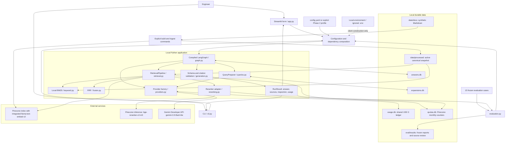
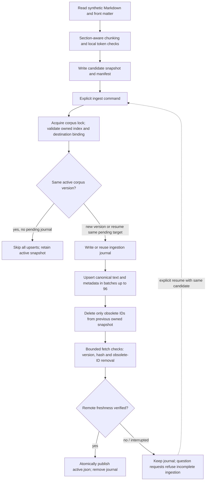
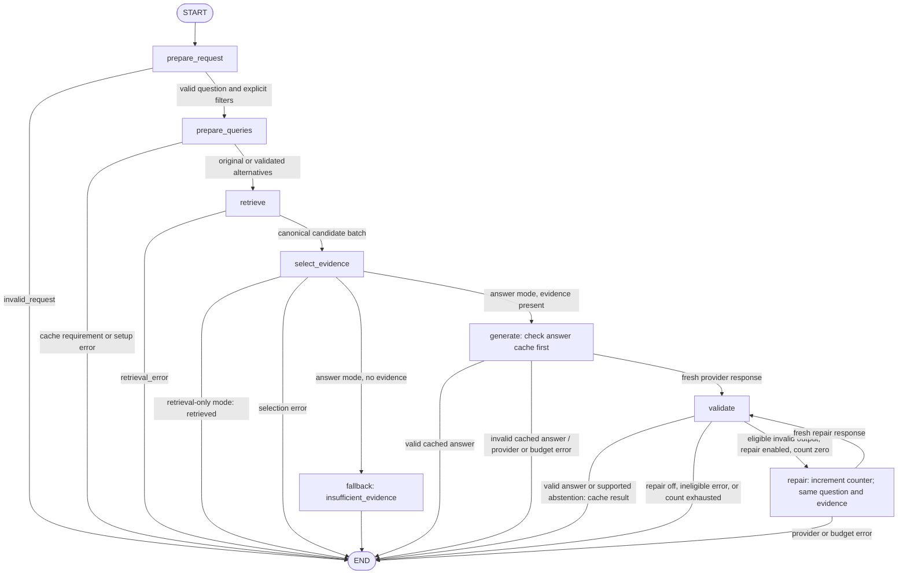
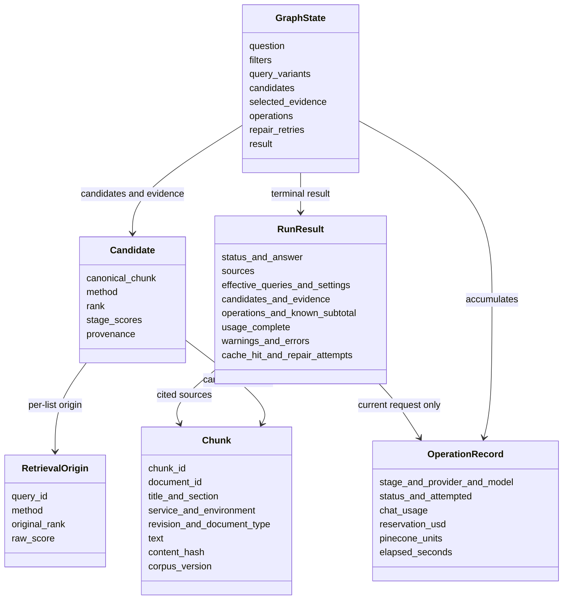
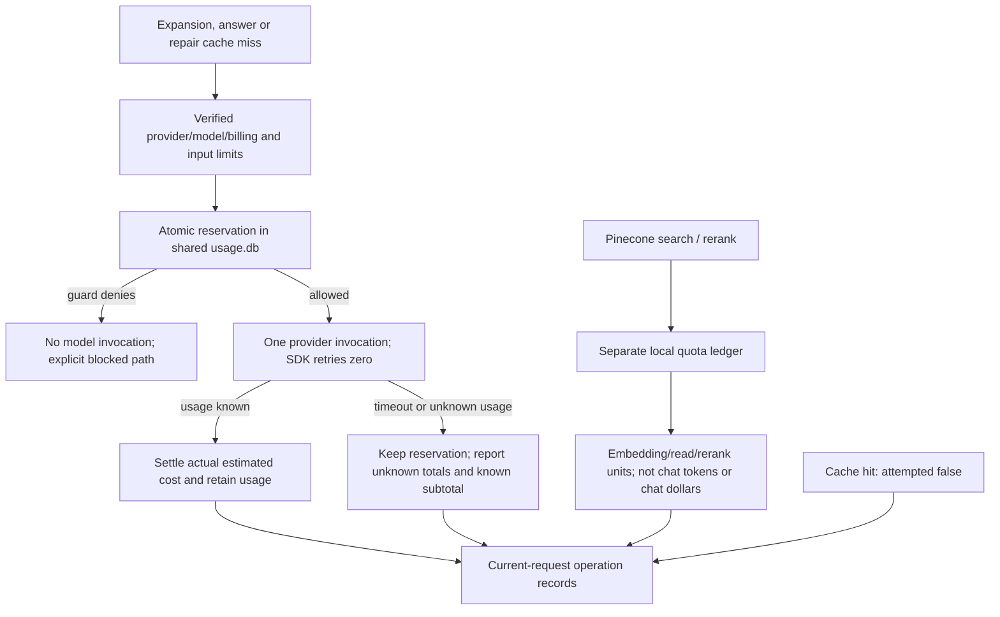

# RunbookIQ architecture and execution guide

This guide documents the implementation on `phase-2`, including the reviewed fixes.
Phase 2 uses Gemini; Nebius is an inactive, offline-tested adapter reserved for
optional Phase 3. These are diagrams of implemented behavior, not proposed services.

RunbookIQ helps engineers find documented troubleshooting checks in nine synthetic
Markdown documents. It returns cited evidence, recommended checks and missing
information through Streamlit or a CLI. It has no connection to a live order
service and cannot establish a current incident cause or execute remediation.

## 1. System architecture



The arrows describe dependencies and data flow, not parallel execution. In
production `compose()` injects clients into node closures. Graph state contains
request data and results, not credentials or SDK clients. Tracing is disabled.
Pinecone manages embeddings internally: this app sends text and canonical metadata,
not locally computed embedding vectors. Local tokenizer files are not model weights.

**Runtime boundary:** Streamlit, LangGraph, BM25/RRF, validation, caches and ledgers
run on the user's machine. Pinecone and Gemini are network services. No separate
web API, queue, background indexer, graph database, conversational memory service,
or production observability integration is deployed.

## 2. Explicit ingestion and publication



Chunk IDs, document metadata, text hashes and corpus version connect citations to
canonical local text. `destination.json` binds the active data to index, namespace,
embedding model and remote host. The index is `runbook-iq`; namespace is
`runbook-iq-v1`. The ownership/configuration checks precede mutations.

Current retained experiment: **nine documents, 21 active sections-v1 chunks**.
The source splitter now includes the reviewed sections-v2 fence-preservation fix;
an explicit future rebuild changes the corpus identity and requires ingestion.
Phase 2 did not rebuild or re-embed the baseline. Chunk target is 400 tokens;
the enforced embedding maximum is 2048, with silent truncation disabled. There is
no scheduled refresh: freshness depends on explicit build/ingest commands.

Normal questions and UI rerenders never ingest. A journal blocks queries even if
an older active file still exists, so the app does not query a partially updated
remote corpus. Ingestion freshness polling is separate from request-time retries.

## 3. Actual LangGraph control flow



`prepare_queries` is a node even when multi-query is off. It then returns only the
original question. A fresh expansion parse/provider/budget failure normally returns
original-only queries with a warning and recorded attempted usage. Required-cache
failure terminates before retrieval. Cached alternatives recheck current lexical
and embedding limits; an over-limit set fails required-cache mode, or falls back to
the original with a warning in ordinary mode. Invalid lexical cache data fails closed.

`generate` is also the name of the cache-lookup node. A `generate` timing does not
prove a model invocation. Cached answers are revalidated against selected evidence;
an invalid cached answer is rejected without a generation or repair call.

Repair is a **graph edge**, not an SDK retry. It is eligible only for a fresh
response with a categorized deterministic validation failure. It never repeats
retrieval or expansion. A second invalid response ends `invalid_output`; transport
errors do not trigger repair. The counter is the termination rule; invocation's
recursion limit of 16 is a backup. `END` means execution stopped, not that its answer
is true. Validation checks structure and citation IDs, not semantic entailment.

| Terminal status | Meaning |
|---|---|
| `answered` | Structurally valid cited answer; manual support may still fail. |
| `insufficient_evidence` | Deterministic empty-evidence fallback or validated model abstention. |
| `retrieved` | Retrieval-only invocation finished; no answer model used. |
| `invalid_request` | Question/filter validation failed. |
| `retrieval_error` | Retrieval, canonical consistency or selection failed. |
| `provider_error` | Provider/setup/required expansion-cache path failed. |
| `budget_exceeded` | Shared chat-dollar guard denied answer or repair. |
| `invalid_output` | Output validation or cached-answer validation failed. |

### LangGraph concepts mapped to this project

- **State:** `GraphState`, a typed request record carrying question, filters, query
  variants, candidates, evidence, operations, repair counter, timings and result.
- **Node:** a Python function reading state and returning only its changes.
  `retrieve`, for example, returns the candidate batch and accumulated operations.
- **Edge:** the next execution step. Conditional edges inspect results or evidence
  to select generation, abstention, repair or termination.
- **Compile and invoke:** `StateGraph(...).compile()` builds the runnable workflow;
  `invoke()` starts a fresh question. The app does not configure a checkpointer.
- **Persistence:** SQLite caches/ledgers are application storage, not LangGraph
  checkpoints. Streamlit session state retains the last displayed result, not a
  multi-turn conversation.
- **Sequential updates:** no parallel retrieval branches or custom state reducers
  are used. The pipeline loops over queries/methods explicitly.

These map directly to [graph.py](../src/runbook_iq/graph.py). The official
[LangGraph Graph API](https://docs.langchain.com/oss/python/langgraph/graph-api)
provides the general framework terminology.

## 4. Retrieval, fusion and selection

```mermaid
flowchart LR
  Original[Original question] --> Prep[Original plus 0-2 validated alternatives]
  Prep --> Verify[Verify active snapshot and destination]
  Verify --> Dense[Each query: up to 5 Pinecone dense hits]
  Verify --> Keyword[Hybrid on: up to 5 local BM25 hits per query]
  Canon[Same active canonical chunks] --> Dense
  Canon --> Keyword
  Dense --> Canonical[Check IDs, text, hash, version and explicit filters]
  Canonical --> Lists[Ranked lists with query/method provenance]
  Keyword --> Lists
  Lists --> Recheck[Recheck active snapshot; reject changed batch]
  Recheck --> Fuse{More than one list?}
  Fuse -->|yes| RRF[Equal-weight RRF; constant 60; at most 15 unique candidates]
  Fuse -->|no| Preserve[Preserve single dense list order]
  RRF --> Select{Reranking enabled?}
  Preserve --> Select
  Select -->|yes| BGE[BGE uses original question and canonical text; truncate NONE]
  Select -->|no| Top[Deduplicate and take configured top-k, up to 5]
  BGE --> Map[Validate indices/scores; map back to canonical chunks]
  Map --> Evidence[Selected evidence: up to 5 chunks]
  Top --> Evidence
```



BM25 favors lexical matches, including complete error codes and their components.
It uses positive IDF, `k1=1.5`, `b=0.75`, whole-corpus statistics and explicit
service/environment filtering before top five. Unmatched terms produce no keyword
candidates. No inferred diagnosis becomes a filter.

RRF sums `1 / (60 + original_rank)` once per chunk per list. It combines ranks,
not incomparable BM25 and embedding scores. Provenance retains each query ID,
method, original rank and raw score. Tie-breaking uses canonical chunk ID. Three
queries and two methods yield at most 30 raw hits, then at most 15 fused candidates.

BGE reorders the candidate pool; it does not retrieve new documents or validate
claims. One request returns up to five selections. Duplicate/out-of-range indices,
wrong cardinality or nonfinite scores fail visibly. Canonical local text is used
instead of trusting provider-returned replacement text. Scores are relevance
signals, not confidence percentages.

## 5. A cached question still performs retrieval

```mermaid
sequenceDiagram
  actor U as Engineer
  participant UI as Streamlit
  participant G as LangGraph
  participant EC as Expansion cache
  participant P as Pinecone
  participant L as Local BM25/RRF
  participant AC as Answer cache
  U->>UI: Submit question
  UI->>G: invoke(question, filters)
  G->>EC: Look up question / corpus / route key
  EC-->>G: Valid cached original and alternatives
  loop Each query, up to three
    G->>P: Dense search with integrated embedding
    P-->>G: Hits and embedding/read units
    G->>L: Keyword hits, when hybrid enabled
  end
  G->>L: Fuse lists; recheck canonical snapshot
  G->>P: One rerank, when enabled
  P-->>G: Selected indices/scores and rerank units
  G->>AC: Look up key including ordered evidence and exact queries
  AC-->>G: Cached answer
  G->>G: Revalidate citations against current evidence
  G-->>UI: RunResult with current operations and zero new chat calls
  UI-->>U: Answer, sources and inspection
```

The answer cache is checked **after** evidence selection. That preserves current
retrieval work and binds reuse to evidence identity. It does not guarantee that a
repeat question produces the same ordering or a cache hit.

Expansion identity includes question, filters, corpus, expansion prompt/schema and
provider route/settings. Answer identity includes question, filters, corpus,
provider/model, answer prompt/schema, generation settings, repair policy, retrieval
configuration, exact query variants and ordered selected IDs/content hashes.

For the user's observed run: three successful searches consumed 14+13+14 = **41
embedding tokens and 3 read units**, plus **1 rerank unit**. Expansion and answer
were cached, so no Gemini calls occurred. Those figures describe that pasted run,
not a general fixed per-question price or a new agent-run measurement.

## 6. Data contracts and storage



The class diagram groups related fields for readability; exact names and validation
constraints are in [schemas.py](../src/runbook_iq/schemas.py).

| Storage | Role | Version-control treatment |
|---|---|---|
| `data/docs/` | Human-readable synthetic source of truth | Tracked |
| `data/processed/` | Candidate/active snapshots, destination binding, journal and lock | Ignored; don't reset during a demo |
| `.runbook_iq/expansions.db` | Validated query sets | Ignored |
| `.runbook_iq/answers.db` | Structurally validated final answers | Ignored |
| `.runbook_iq/usage.db` | Shared cumulative chat-dollar reservations/settlements | Ignored; never reset to bypass budget |
| `.runbook_iq/quotas.db` | Local monthly embedding/read/rerank counters | Ignored; not account-wide balance |
| `.runbook_iq/pinecone-usage.jsonl` | Local returned unit records | Ignored |
| `.runbook_iq/diagnostics/` | Explicit opt-in rejected-response diagnostics | Private and ignored |
| `eval/results/` | Recorded evidence, comparisons, failures and manual reviews | Curated tracked artifacts; personal outputs stay separate |
| `.env` | Keys loaded locally | Ignored; never show in a recording |

## 7. Usage and budget boundaries



Current Gemini route is user-confirmed free tier; the app does not enable paid
Gemini fallback. The cumulative estimated paid-usage guard is USD3, shared across
phases. Future paid Nebius calls require verified rates and conservative,
provider-enforced billable bounds; promotional credits do not make consumption free.

Maximum per question: **one expansion + one answer + one repair = three chat
attempts; up to three dense searches and one rerank**. Cache hits/empty evidence
can reduce calls. A service error is explicit; the app does not silently switch
providers or upgrade billing.

`usage_complete` currently describes **chat input/output/cost completeness**, not
all Pinecone fields or optional reasoning breakdown. `known_subtotal` sums only
known chat values; unknown totals remain null. Pinecone usage is in `units`.
`reservation_usd: null` is normal for cached or Pinecone operations. Cache-hit
operation duration is not independently measured and defaults to zero; node timing
still includes cache lookup. Repeated validation after repair overwrites that node's
timing entry; use evaluation `request_seconds` for request wall time, not a sum of
node timers. Composition and intentional evaluation pauses are reported separately.

Pinecone embedding/rerank quota guards reserve locally before invocation; read units
are response-based monitoring, not an enforced per-call maximum. Other applications'
consumption is outside these counters. Unknown outcomes remain visible.

## Profiles, evidence and code map

| Profile | Hybrid | Rerank | Multi-query | Repair |
|---|---:|---:|---:|---:|
| `config.yaml` (default) | false | false | false | false |
| `config.phase2-hybrid.yaml` | true | false | false | false |
| `config.phase2-rerank.yaml` | true | true | false | false |
| `config.phase2-multiquery.yaml` | true | true | true | false |
| `config.phase2-repair.yaml` | true | true | true | true |

The app reads `RUNBOOK_IQ_CONFIG`, otherwise `config.yaml`. Flags are configuration,
not an automatic classifier's decision about whether a question needs a feature.

| Responsibility | Implementation |
|---|---|
| Entry/composition | `app.py`, `cli.py`, `config.py` |
| Canonical build/sync | `corpus.py`, `tokenization.py`, `ingestion.py` |
| Query preparation/cache | `queries.py`, `cache.py` |
| Retrieval/selection | `retrieval.py`, `keyword.py`, `fusion.py`, `reranking.py`, `pinecone_store.py` |
| Graph and validation | `graph.py`, `generation.py`, `schemas.py` |
| Provider/accounting | `providers.py`, `budget.py`, `quota.py`, `usage.py`; inactive `nebius.py` |
| Evaluation | `evaluation.py`, `eval/questions.json`, `eval/phase2-rubric.md` |

Last application test gate: **135 passing tests**. Four fixed retrieval arms each
achieved expected-section recall 1.0 on 12 answerable cases, with no measured gain.
The resumed15-case answer run had12/15 frozen status matches; first attempts had
11/15 because one search failed. q08 contradicts retrieved field documentation;
q02 omits a caveat; q04/q11 abstain conservatively. No faithfulness percentage is
claimed. See [source review](../eval/results/phase2-review.md) and
[independent engineering review](phase2-code-review.md).

## Using these diagrams

The seven Mermaid blocks above are the detailed editable diagrams. Their standalone
sources are in [diagrams/](diagrams/). Five simplified,1920×1080 SVG/PNG visuals
support screen recording; see [visual index](diagrams/index.html). The simplified
runtime visual omits detailed terminal branches; section3 above is authoritative.
Use [demo preparation](demo/README.md) for the recording order and narration.
