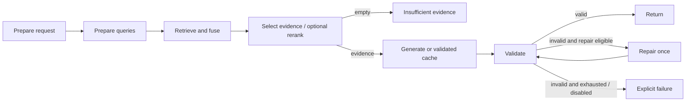

# RunbookIQ Phase 2 design

Date: 2026-10-18. Status: written specification awaiting user review.
Baseline: `e15502e` on published `phase-1`; design branch: `phase-2`.
Authority: `RunbookIQ-Codex-Handoff.md`, especially sections 4, 6–8.
Execution preference remains Native. This is the agreed second phase, not a new
product direction. Detailed implementation planning follows written-spec approval.

## Outcome and current architecture

Extend the runnable incident-evidence assistant with local BM25 and rank fusion,
a dedicated reranker, bounded query expansion, a second chat provider, one output
repair attempt, and comparative evaluation. Keep every feature independently
switchable and all switches off by default. Dense-only Gemini remains runnable.
Continue using the nine synthetic documents; no live-system diagnosis, remediation,
deployment, authentication, semantic grading agent, or open-ended loops.

Ingestion already publishes canonical chunks and a destination-bound active
snapshot after Pinecone freshness checks. The LangGraph workflow prepares a
request/query, retrieves canonical evidence, selects five chunks, generates one
Gemini response, validates its structure/citations and returns a terminal result.
SQLite stores answer caches and cumulative usage reservations. Clients and secrets
stay outside graph state. Streamlit submits requests without ingesting or rerunning
the model on ordinary UI rerenders.

Latest Phase 1 live evaluation has 10 answers and 5 abstentions; 13/15 match frozen
status expectations. The later offline validation audit accepts 14 saved responses
and rejects q09. Retrieval already finds all expected sections in the top five for
the 12 answerable cases. Improvements are therefore hypotheses: retrieval changes
alone will not fix q02's omitted caveat or prove semantic grounding.

## Material gaps to address

1. Candidate records need per-query/per-method provenance; one rank and score map
   cannot explain multiple retrieval lists without losing information.
2. Graph usage must accumulate expansion, answer and repair attempts, including
   failures and cache hits, rather than report only the final response's usage.
3. Evaluation must distinguish retrieved candidates from final selected evidence;
   current retrieval-only execution bypasses the graph's query/selection nodes.
4. Reranker access and request bounds need a live check. Nebius credentials,
   selected model, pricing and billable token bounds need verification before use.
5. Answerability versus missing live observations needs a prospective scoring rule.
   Preserve the original questions, expectations, outputs and failures.

## Retrieval and canonical data

BM25 reads the *active* canonical snapshot used by Pinecone, not a fresh independent
split of Markdown. Build its small in-memory index from those records; cache only
by corpus version plus tokenizer/scoring version. Do not rebuild or reingest the
corpus just to add keyword search. Existing sections-v1 active records remain
valid; a future explicit sections-v2 rebuild requires its own ingestion checkpoint.

Use deterministic BM25 with positive IDF, `k1=1.5`, `b=0.75`:
`idf(t) = log(1 + (N - df(t) + 0.5)/(df(t) + 0.5))`.
Score each unique query token once. Tokenization case-folds text, preserves complete
code/error identifiers (underscores, internal hyphens/dots), and adds their component
words without double-counting an identical token at the same occurrence. Do not
stem, discard negation, or download language models. Index title, section and text
once per chunk using this same tokenizer for queries. Include only positive-score
matches; unmatched keyword queries return no candidates. Break score ties by ID.

Apply explicit service/environment filters to eligible results before taking five;
use whole-snapshot BM25 statistics consistently across filters. No inferred cause
filters. Verify active version and destination binding before and after the bounded
retrieval batch; discard the batch on corpus change. Never mix snapshot versions.

With hybrid enabled, retrieve up to five dense and five BM25 hits per query.
Each `(query_id, method)` contributes one ranked list. Deduplicate within a list,
then use equal-weight RRF: `score(chunk) = sum(1 / (60 + rank))` over lists
containing that chunk. Ranks start at one; ties break by canonical chunk ID.
Never sum raw BM25 and dense scores. Keep at most 15 unique fused candidates and
five final evidence chunks. At three queries this bounds raw hits at 30 and dense
searches at three. Dense-only single-query preserves existing ordering; multiple
dense-only query lists also use RRF. BM25 failure or dense retrieval failure ends
as `retrieval_error`; no silent change to the requested retrieval configuration.

Extend `Candidate` additively with a default-empty provenance list. Each entry
records query ID, method, original one-based rank and raw score. Keep canonical
chunk, current-stage rank/method and separate `fusion`/`reranker` scores. Old saved
Phase 1 results remain readable. Store query text once in the run's query list.

## Dedicated reranking

Select Pinecone-hosted `bge-reranker-v2-m3`. Public Starter pricing lists this model
and 500 included requests/month; actual remaining allowance is not verified.
The standalone inference call can rerank the fused local/dense candidate union.
Use the original question and `{id, text}` documents, one text field, up to 15
candidates, `top_n=min(5, candidate_count)`, and `truncate=NONE`. Map result indices
back to the input candidates and reject duplicate/out-of-range indices or nonfinite
scores. Preserve canonical text and provenance. Ranking is not entailment checking.
[Pricing](https://www.pinecone.io/pricing/),
[request format and limits](https://docs.pinecone.io/guides/search/rerank-results).

Published BGE limits are 100 documents and 1024 tokens per query/document pair.
Keep truncation disabled so oversize input fails visibly. Before enabling live
reranking, inspect model metadata with the installed SDK, verify the request shape
and access with one small synthetic call, and record usage/latency. Do not use the
embedding tokenizer as an exact BGE token counter. If an exact pinned tokenizer is
unavailable, rely on the service's strict no-truncation validation; never silently
shorten evidence. A reranker error produces an explicit `retrieval_error` with a
safe stage code. The user can disable the switch to run fusion alone. No paid model
substitution, account upgrade, automatic retry or hidden fallback.

## Query preparation and providers

With multi-query disabled, retain the original query only. When enabled, make at
most one structured call for up to two alternatives; original stays first and is
never rewritten. Validate nonempty strings and request/token limits, normalize
whitespace for deduplication, and reject unsafe alternatives. Require original
code identifiers, quoted literals, numbers and recognized service names to survive;
require negation markers to survive and reject newly introduced diagnosis claims.
The checker is conservative and lexical, not a proof of equivalent meaning. Prefer
original-only retrieval when a rewrite cannot pass these checks. Prompt explicitly
prohibits invented causes, identifiers or observations.

On expansion parse/provider/budget failure, record a safe warning and attempted
usage, then search the original only. A later paid answer still requires its own
budget reservation. Cache validated expansions by original question, filters,
corpus version, expansion prompt/schema, provider/model and generation settings.
Comparisons reuse the same recorded expansion set; failures are recorded rather
than cached indefinitely as successful rewrites.

Keep top-level `provider`/`model` as the answer route for compatibility; add an
independent expansion route with the same explicit billing/rate/bound fields.
The expansion route defaults to the verified Gemini answer route. Repair uses the
answer route. Provider factories are task-aware but small; no gateway or plugin
framework. Gemini's native integration remains in use.

Add Nebius through its documented OpenAI-compatible Chat Completions endpoint,
using a thin adapter that preserves raw usage and finish reason. Do not assume
compatibility includes every nonstandard reasoning field. Nebius documents JSON
schema output, with support depending on model. Exact model choice is a just-in-time
service decision: select an accessible low-cost JSON-capable model only after
recording its model ID, input/output pricing, context limit, reasoning mode, and
enforced total output bound. Until then the Nebius route fails preflight with a
clear configuration error and Gemini remains usable. No guessed price or model ID.
[Nebius quickstart](https://docs.tokenfactory.nebius.com/quickstart),
[structured outputs](https://docs.tokenfactory.nebius.com/ai-models-inference/json).

## LangGraph flow and one repair

Terminal error edges and cached-success exits are omitted from this picture for
readability, but remain explicit in code. A node is a unit of work returning state
updates; a conditional edge chooses the next node from those updates. The repair
cycle is bounded by state: increment `repair_retries` before invoking the model,
allow only zero-to-one, and route the second invalid result to `END`. The graph's
recursion limit is a backup, not the primary termination rule. `END` means execution
finished, not that an answer was correct. Sequential nodes keep state merging simple;
parallel branches/reducers and checkpoint persistence are unnecessary here.

Repair is eligible only for a model response that fails deterministic schema or
citation validation, with repair enabled and a successful budget preflight. Pass
the original question, identical selected evidence, rejected response as untrusted
data, safe error code and answer schema. Do not retrieve again or expand again.
Allow a supported abstention. Provider transport failure does not trigger repair.
If the repair fails validation, return `invalid_output`; on invocation/budget failure
return `provider_error`/`budget_exceeded`, retaining the original validation code.
Do not claim semantic verification or add an LLM grounding judge.

Current invalid cache entries continue to fail closed with zero new calls. Bump
answer-cache namespace for Phase 2 contracts rather than repairing legacy cached
answers silently. Only validated final answers are cached. Cache keys include
requested and effective retrieval configuration, exact queries, model/prompt/schema,
corpus version, ordered evidence IDs/hashes, and repair policy. A valid answer cache
hit skips answer and repair; retrieval/expansion work already performed remains in
the current run's usage and timings, never copied from a previous run.

## Usage, errors and budget

Reuse the existing persistent USD 3 ledger across branches, phases and restarts.
Expansion, answer and repair each reserve before invocation. Promotional credits
still count at the model's listed estimated consumption; do not label Nebius free
because credits cover the invoice. Paid fallback remains disabled.

Add per-operation records for attempted calls, cache hits, provider/model, token
counts, cost/reservation and timing. Aggregate known values without converting
missing usage to zero: expose a known subtotal and completeness flag; retain unknown
reservations. Count an attempted model call at the invocation boundary, not when
client/cache setup throws. Normalize reasoning without double-counting tokens.
Paid calls require verified rates and a conservative input plus all-billable-output
upper bound; block models whose hidden reasoning cannot be bounded. Preserve atomic
concurrency protection and record SDK retries as zero.

Maximum chat attempts per request: one expansion + one answer + one repair = three.
Empty evidence can still have incurred expansion, but no answer/repair. At most
three dense searches and one reranker request; no retrieval retries. Record Pinecone
embedding/read/rerank units separately from chat usage, with monthly local counters
and configured allowance guards. Local counts cannot establish other projects'
consumption; quota errors stop live experiments and do not trigger plan upgrades.
Errors and inspection data exclude credentials, headers and raw SDK exceptions.

## Inspection and evaluation

Expose feature switches in configuration and a small Streamlit inspection expander:
original/alternative queries, requested versus effective stages, candidate provenance,
distinct scores, selected IDs, repair count, operation usage and timings. Secrets
stay in local environment variables. Show intermediate data already in the result;
opening an expander must never call a model or ingest.

Use one shared retrieval pipeline for graph execution and retrieval-only evaluation.
Report top-five metrics at both fused retrieval and final selection, plus relevant
section recall in the pre-rerank pool. Answer-mode evaluation uses that invocation's
actual evidence. Freeze corpus, questions, model/prompt, parameters and criteria per
comparison; hash them into each report. Record failures and incomplete runs.

Before Phase 2 runs, version a prospective scoring rubric alongside the original
questions: distinguish answering a request for documented checks from establishing
a live cause. A documented-checks answer can be `answered` while requesting missing
live observations; a request for an unavailable fact/cause requires abstention.
Assess factual coverage, support, clarification, and status separately. For q04/q11,
keep original expected statuses and report the conservative disagreements; a
supplemental manual rubric must not overwrite baseline accuracy. Reaudit saved
Phase 1 responses under the same supplemental rubric before comparing it to Phase 2.
All 15 cases have been observed; comparisons are regression experiments, not unseen
generalization tests. No prompt changes are bundled into retrieval ablations.

Run dense; hybrid; hybrid+reranking; hybrid+reranking+multi-query. Compare retrieval
first, then targeted answers at each runnable milestone and a final fixed 15-case
answer run. Keep repair off for retrieval ablations; evaluate repair separately
with injected invalid responses for deterministic termination tests, then a small
live check if a real invalid response occurs. Compare cold/cache latency separately.
Preserve every previous result; do not promise quality gains on this small corpus.

## Runnable milestones and acceptance

| Milestone | Runnable outcome | Required evidence |
|---|---|---|
| P2.1 Hybrid | Existing CLI/graph answer with BM25 + RRF; switches off reproduce dense path | Offline identifier/filter/provenance/fusion/snapshot tests; retrieval-only comparison; one supported cited answer |
| P2.2 Reranking | Same question through hybrid + dedicated reranking | SDK/access/limits smoke check, strict mapping/error tests, retrieval comparison and selected-source inspection |
| P2.3 Multi-query | Up to three safe queries with cached expansion | Deduplication/identifier/negation/fallback tests; measured call bounds; reproducible cached-query comparison |
| P2.4 Nebius | Independently select answer and expansion providers | Verified model/rates/bounds/credits, offline normalized-usage and budget tests; one live structured response and one cited graph answer |
| P2.5 Repair | Invalid fresh output can take one explicit repair edge | Invalid→valid and invalid→invalid termination tests; budget/provider failures; accumulated usage; no forced success |
| P2.6 Inspect/package | UI shows retrieval decisions; comparative report and demo updated | UI reruns make no calls; final fixed evaluation with source review; full offline suite and independent final code review |

Each milestone keeps the application runnable and records actual checks, costs,
remaining gaps and next action in PROGRESS.md. If Nebius access is unavailable,
continue independent Gemini/repair/UI work but mark second-provider live acceptance
incomplete; do not call Phase 2 finished. No paid/live calls are needed for this
design checkpoint. Implementation plan and product edits await the required reviews.
